<picture>
  <source media="(prefers-color-scheme: dark)" srcset="assets/header-dark.svg">
  <source media="(prefers-color-scheme: light)" srcset="assets/header-light.svg">
  
</picture>

 

Self-taught systems programmer. I spend most of my time close to the metal: reading disassembly,
taking binaries apart to see what they *actually* do, and writing C, C++ and Rust that respects
the machine underneath.

Away from the debugger I read philosophy and theology. Different subject, same habit: trace it
back to first principles, and don't trust what you can't verify.

 

<picture>
  <source media="(prefers-color-scheme: dark)" srcset="assets/toolchain-dark.svg">
  <source media="(prefers-color-scheme: light)" srcset="assets/toolchain-light.svg">
  
</picture>

  

<picture>
  <source media="(prefers-color-scheme: dark)" srcset="https://raw.githubusercontent.com/tmpleos/tmpleos/output/snake-dark.svg">
  <source media="(prefers-color-scheme: light)" srcset="https://raw.githubusercontent.com/tmpleos/tmpleos/output/snake-light.svg">
  
</picture>

<picture>
  <source media="(prefers-color-scheme: dark)" srcset="assets/footer-dark.svg">
  <source media="(prefers-color-scheme: light)" srcset="assets/footer-light.svg">
  
</picture>
